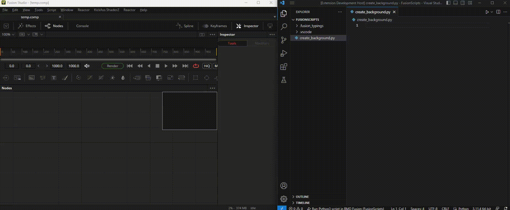
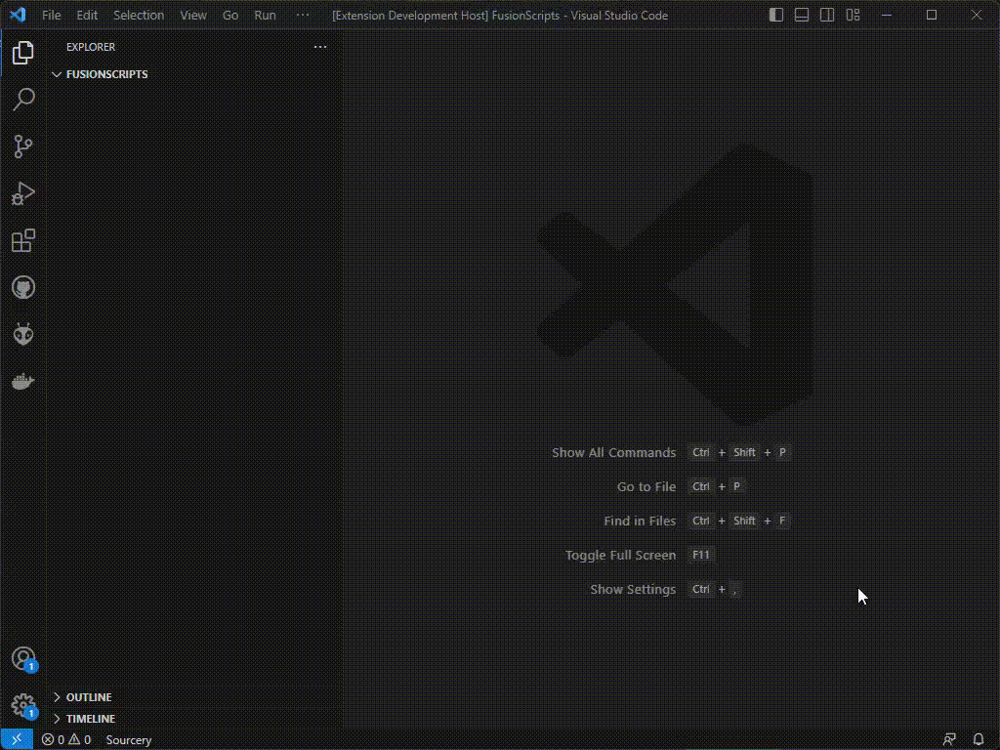
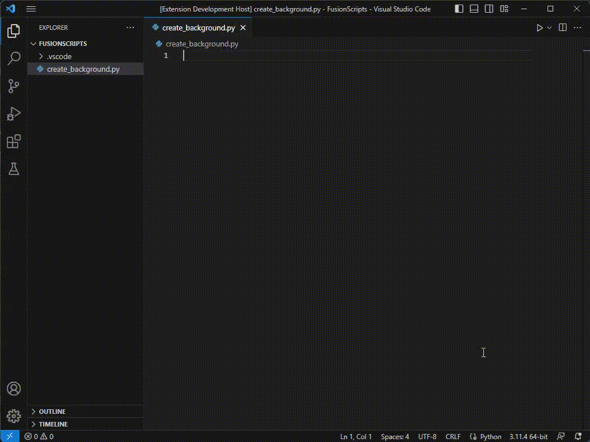

# BMD Fusion scripting extension for VSCode

Helps you setup your workspace to work as flawlessly as possible when scripting for BMD Fusion.



## Installation

Download it from the marketplace: <https://marketplace.visualstudio.com/items?itemName=EmberLightVFX.bmd-fusion-scripting>

## Features

* Generate launch.json configs for your Fusion instance
  * Custom filepaths
  * Custom host
  * Lua and Python
  * Custom name
* Add python stubs for Fusions python API to get IntelliSense support.
* Execute scripts directly from VSCode

## Generate launch configs


Quicky setup launch configs for your workspace to launch your Fusion scripts directly from VSCode to your wanted Fusion host

## Add python stubs for Fusions python API


Add fusion stubs for your workspace to get IntelliSense code suggestions directly in VSCode!

## Execute scripts directly from VSCode


With everything installed you can now quick and easy do scripting for Fusion!

## Development

### Update BMD-Fusion-Scripting-Stubs submodule

``` bash
git submodule update --remote --merge
```

### Npm initialization

``` bash
npm install
npm run compile
npm run watch
```

Before running and debugging the extension, run `npm run watch`

## To build

First run the npm initialization
Make sure you have vsce installed

``` bash
npm install -g @vscode/vsce
```

Update the submodule and then package

``` bash
git submodule update --remote --merge
vsce package
```

## To publish

``` bash
vsce publish
```

**Enjoy!**
